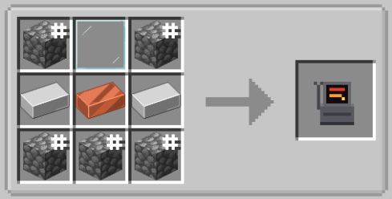

[English](README.md) | **简体中文**

# Ultracraft

真正的 ULTRAKILL，运行在真正的 Minecraft 1.21.11 里。ULTRAKILL 与 Minecraft 并行运行并绘制在其窗口中；Minecraft 的方块与生物变成了 ULTRAKILL 的世界与敌人。支持带词条的 Boss、P 评分、商店终端、能力升级、以地狱各层为主题的竞技场、战斗专属音乐、Cyber Grind（电子血宫）、作弊菜单，以及局域网联机。

你需要拥有 **ULTRAKILL**（Steam）与 **Minecraft Java Edition**。仅限 Windows。

## 安装

你无需手动向 ULTRAKILL 中安装任何内容。Minecraft 启动时，Ultracraft 会通过 Steam 自动定位 ULTRAKILL 并完成必要配置：若未安装 BepInEx 5，会自动装配；同时安装 UltraBridge 插件，并在模组更新时同步自动更新。标题界面上的弹窗消息会提示具体操作状态。游玩时请保持 Steam 处于运行状态。

启动该游戏实例。ULTRAKILL 将自动同步启动（并随 Minecraft 一并退出），并跳过两段开场直接进入主菜单、随即切入沙盒；进入任意世界即可化身 V1（随时按 F8 切回原版史蒂夫）。

**手动安装：** 安装对应 Minecraft **1.21.11** 的 **Fabric Loader**（[安装器](https://fabricmc.net/use/installer/)），并将对应 1.21.11 的 **Fabric API**（[Modrinth](https://modrinth.com/mod/fabric-api)）与 `ultracraft-x.y.z.jar`（取自 Releases 发布包中的 `Ultracraft.zip`）放入 `.minecraft/mods` 文件夹。

未找到 ULTRAKILL（安装在非标准路径）？在 `config/ultracraft.properties` 中指定游戏路径：`ultrakillDir=D:\\Games\\ULTRAKILL`（注意使用双反斜杠）。若已安装 BepInEx 6：Ultracraft 需要的是 BepInEx 5。若仍有问题：请手动将 [BepInEx 5](https://github.com/BepInEx/BepInEx/releases)（x64）解压至 ULTRAKILL 根目录，并将 `Ultracraft.zip` 中的 `UltraBridge.dll` 放入 `ULTRAKILL/BepInEx/plugins/UltraBridge/`。

终端机的中文需要额外一个字体包（ULTRAKILL 自带字体没有汉字）：把 `fontpack.bundle` 放到 `ULTRAKILL/BepInEx/plugins/UltraBridge/` 即可。没有它时终端机保持英文，其余汉化不受影响。

指令帮助：`/uc help`。在他人联机世界中，发放物品、武器、升级与召唤 Boss 等特权指令仅房主与管理员可用。

卡在 “ULTRAKILL connected - loading V1...”？请更新至最新版本：旧版本在未完成新手教程的 ULTRAKILL 存档上会无限期等待。新版本会在提示信息中明确列出当前正在等待加载的关卡。

Minecraft 启动时崩溃并提示 “Unsupported class file major version 65”？说明 Fabric Loader 版本与 Minecraft 1.21.11 不匹配：请运行最新版 [Fabric 安装器](https://fabricmc.net/use/installer/)，选择 1.21.11 的最新 loader（0.19 或更高版本），并启动对应配置。

各版本改了什么：[更新日志](CHANGELOG-zh.md)（每个版本也都在 [Releases](https://github.com/oneotok1/Ultracraft-Deep/releases) 有对应说明）。

## 设置

点击 **Ultracraft...**（位于标题界面、暂停菜单、选项界面，或输入指令 `/uc settings`），各专项设置页面如下：
- **Enemies & Bosses**：Minecraft 生物、ULTRAKILL 敌人、Boss（生成间隔、难度倍率、词条概率）、竞技场、史蒂夫状态下的敌人遭遇，用于定制交互名单的 **Mob Damage Filter**（生物伤害过滤），用于挑选暗处会出现哪些 ULTRAKILL 敌人的 **Enemy Spawn Filter**（敌人刷新过滤），以及用于把某些词条从BOSS随机池里排除的 **Boss Trait Filter**（BOSS词条过滤器）。
- **Gameplay**：自动成为 V1、方块破坏规则、爆炸灭火、被击飞生物的摔落伤害、吸收护盾算作血上限、打击定格时长、随 Minecraft 同步自启 ULTRAKILL。
- **Shop & Rewards**：风格奖励结算、连击提示文字、OP 商店超额数值、高分辨率商店界面。
- **Performance**：ULTRAKILL 画面渲染分辨率与帧率上限、锁步同步、低延迟帧。
- **Music**：ULTRAKILL 战斗音乐、Boss 主题曲、非战斗平静曲目、各项音量调节。
- **Cheats**：ULTRAKILL 原版沙盒作弊与 Ultracraft 特供作弊。
- **ULTRAKILL Settings**：灵敏度、视野、屏幕震动等原版参数在模组中的呈现表现。
- **ULTRAKILL Controls**：改绑 ULTRAKILL 键位，并为每把武器绑定独立直达快捷键。

## 敌人、竞技场与奖励

ULTRAKILL 的敌人会在暗处自然生成，生成的种类与所处生态群系及维度紧密挂钩：
- 平原：躯壳（husks）；
- 沙漠与恶地：贪婪层的士兵、偶像与哨兵；
- 沼泽：暴食层的血肉之躯；
- 丛林与深层洞穴：暴虐层的机械巨怪；
- 下界：按群系分布恶魔（灵魂沙峡谷为灵魂系，绯红森林为血肉系，玄武岩三角洲为重工业机群）；
- 末地：天使神族（Virtues 美德、Powers 能天使、Providence 神谕）。

**Enemy Spawn Filter**（敌人刷新过滤，位于 Enemies & Bosses 页）决定上述哪些种类可以出现；BOSS与血宫的波次不受它影响。

ULTRAKILL 敌人也会主动与 Minecraft 敌对生物交战。能击飞 V1 的重拳、践踏、光柱或爆炸，同样能将原版生物炸飞同等距离，V1 自己的爆炸也照样把它们抛出去。这样被击飞的生物落地时会承受摔落伤害，抛得够高就会摔死——**Knockback Fall Damage**（击退摔落伤害，Gameplay 设置，默认开启）可以关掉它，回到 ULTRAKILL 自己的规则：落地之前不受任何伤害。

**V1 生命值与 Minecraft 严格等比换算。** V1 的基础 100 生命（低难度血条 200）直接映射原版 Minecraft 生命上限：20 满血对应 100 V1 生命。生命提升效果或任何增加红心的模组都会等比提升 V1 的血池（上限为 V1 自身满血的 4 倍：普通难度 400，低难度 800）。金苹果或药水提供的伤害吸收心（黄心）以深色段渲染在 ULTRAKILL 血条顶端，原版生物攻击与 ULTRAKILL 命中均优先消耗吸收池。开启 **Extra Blood Counts as Health Cap**（Gameplay 设置，默认开启）时，攻击吸血可直接回填黄心至上限；关闭时黄心仅作为不可回复的一次性防伤护盾。

**生物重击前亮起黄光警示。** 出现黄光并非必中：在窗口期内出拳即可完美弹反，后撤出攻击范围即可闪避，站立不动则硬吃伤害。手持长矛的生物会在长矛最大攻击距离处闪烁黄光，而非贴身距离，确保你在枪尖刺中前拥有充足的弹反判定窗口。

**爆炸雕刻球形弹坑。** 模组采用平滑球形剔除算法替代 Minecraft 原版的射线投射，爆炸边缘伤害平缓递减，不再留下参差不齐的阶梯状方块残余。掉落物实体免疫爆炸伤害，确保击杀战利品不会被火箭或砸地爆破误摧。**Blasts Put Fire Out**（Gameplay 设置）可扑灭范围火焰，并防止爆炸本身在弹坑内引燃烈火。

**Mob Damage Filter**（Enemies & Bosses）可精确指定哪些 Minecraft 生物允许与 ULTRAKILL 机制交互。被过滤的生物在 ULTRAKILL 视角下完全无视：武器与弹道穿透、拳击无法弹反、Whiplash 无法抓取、爆炸不产生冲击位移，且 ULTRAKILL 敌人对其完全视而不见。支持按类别（hostile 敌对、neutral 中立、passive 被动、other 其他）批量切换，内置 All、Invert、Defaults 快捷操作，搜索框全面支持 JEI 语法（空格与、`-` 排除、`|` 或），装了拼音模组时亦可拼音搜索。

**竞技场**在世界未探索区域自然生成，对应地狱各层级：
- 主世界：序幕（Prelude）、边狱（Limbo）、色欲（Lust）、暴食（Gluttony）、贪婪（Greed）、愤怒（Wrath）与暴虐（Violence）；
- 下界：异端（Heresy）；
- 末地：至高圣所（Prime Sanctum）。

每座竞技场皆有守关 Boss 恭候。化身 V1 步入圆环即拉响该层标志性战斗曲目并开启战斗。击败 Boss 后台座将浮现丰厚战利品宝箱。使用指令 `/locate structure #ultracraft:arenas` 可定位最近的竞技场。

**风格奖励**：击杀 Minecraft 生物计入风格评级与连击计数。达到 S 及以上风格评级的击杀会奖励额外经验与战利品。每维持该评级连续击杀 5 只生物必定触发大奖，并额外奖励大量 P 点。评级越高战利品越丰厚：SSS 级奖励钻石与金苹果，ULTRAKILL 级甚至奖励下界合金。

## 音乐

**Ultracraft... → Music → Fight Music** 可自由设定战斗背景音乐：
- 关闭；
- 每场战斗随机播放一首 ULTRAKILL 曲目；
- 官方原声带自选：主线关卡曲、至高圣所曲、电子血宫曲目；
- 本地自定义音乐：将 mp3、ogg 或 wav 文件放入 `.minecraft/ultracraft/music` 文件夹（菜单中提供 **Open Your Music Folder** 快捷按钮），即可在 **Your Music** 分组下点播。

Boss 与专属竞技场默认播放其官方专属主题曲（V2: Versus，Minos Prime: Order...），播放期间 Minecraft 原版音乐自动静音。**Boss Music & Intros...** 支持针对单个 Boss 分别配置音乐（(Default)、关闭、任意官方曲目或本地歌曲）。针对加百列（两场对决）、米诺斯原体与西西弗斯原体，还可自由选择入场形式：采用原版对白或由游戏台词混剪的特制版（如加百列 6-2 再战：“IS THIS WHAT I LOST TO!? YOU'RE GETTING RUSTY, MACHINE! ...HERE AND NOW!”）。加百列入场亦支持设为 `(Default) Auto`（初见原版台词，再战自动切换为挑衅）或 `Level Intro`（强制关卡开场白）。

## Boss 入场与退场

开启 **Boss Intros**（Enemies & Bosses；可设为 Short 短版或 Full 完整版）后，Boss 将还原原版关卡登场演武：ULTRAKILL 风格标题卡、专属登场动画、全程语音与字幕。登场演武期间 Boss 处于无敌受保护状态。开启 **Boss Deaths** 后，击败 Boss 将呈现完整退场动画：米诺斯与西西弗斯原体屈膝跪地、吐露终末遗言并化作光柱升天爆炸；加百列狂怒咆哮（“THIS IS NOT OVER!”）或不可置信（“Twice!?”）后匿迹遁走。

**每一场 Boss 遭遇均完全独立配置。** V2、装备勾爪手臂的二阶段 V2、地狱判官加百列、憎恨使徒加百列在 Boss Setup 中皆为独立条目，各自拥有独立的战斗阶段、生命上限、移动攻速、伤害倍率、专属词条、练习模式与 **Fight Now**（立刻开战）。加百列的开场语音随对战胜负记录动态演化：初次见面发表长篇演说，往后对决自动切换为再战挑衅。战败退场的 V2 亦保持机械身躯完整退场，不再碎裂散落为零件残渣。

## 作弊

**Ultracraft... → Cheats** 划分为两大功能区：
- **ULTRAKILL 原版沙盒作弊**：穿墙（noclip）、飞行（flight）、无敌（invincibility）、无武器冷却、无限蹬墙跳、致盲敌人、敌人内讧、清除全图敌人（Kill All Enemies）、**生成手臂（Spawner Arm）**（默认关闭；开启后进驻第 6 武器槽，可随意放置敌人与道具）等。
- **Ultracraft 专属特供作弊**：无限 P 点、解锁全武器与手臂、一击必杀、慢动作（0.5x）、超绝极速（+60% 移速）、无限体力、永不饥饿。
- **Boss Setup...**：各 Boss 独立配置面板。初见或再战形态（V2、加百列）、是否进入世界自动轮换、练习赛模式、血量/速度/伤害倍率调节、开场即进二阶段、随机/关闭/指定词条、还原特定关卡机制（V2 残血撤退、看门犬依次唤醒、给摆渡人一枚硬币跳过战斗、电子血宫版原体）、自定义战歌与入场式，以及 **Fight Now**。

上述选项均为 Ultracraft 本地配置（存储于 `config/ultracraft.properties`），绝不会篡改 ULTRAKILL 本体的存档与设置。在单人世界或自己主持的联机房间中随时可用；在他人服务器中仅限管理员使用。

## 性能优化建议

模组双引擎并行并共享显卡渲染。在 **Ultracraft... → Performance** 中进行如下调节：
- **Low-End PC Preset**（低配预设）：一键将各项参数调整至流畅低功耗档位（后续仍可微调）；**Reset to Defaults** 可一键恢复初始值。
- **ULTRAKILL Resolution**（渲染分辨率）：设为 540p、480p 或 360p 能带来最显著的帧率飞跃（默认 720p）。
- **Effects Quality**（特效品质）：Medium 或 Low 将采用轻量级爆炸、火焰与生成特效，关闭环境粒子并降低同屏血液残余；Low 档进一步关闭受击火花与阴影投射。
- **Blood Stains**（血渍留存量）：限制 Minecraft 方块上吸附的血迹贴图上限（可选 Off、500、1,500、4,096 或 All 全量）。
- **Extra Gore**（额外血腥效果）：关闭后仅保留 ULTRAKILL 原版击杀血迹。
- **Terrain Range**（地形同步视距）：将同步至 ULTRAKILL 的地形范围从 128 格缩小至 64 或 96 格，大幅降低双端运算负荷。
- **ULTRAKILL FPS Cap**（帧率上限）：Match Minecraft（默认）随原版帧率限制平滑锁定；低配显卡下调低该帧率可为 Minecraft 预留更多显卡算力。
- **Low-Latency Frames**（低延迟帧，默认开启）：ULTRAKILL 渲染完成后即时交割画面，大幅消除输入延迟。
- **Sharp Shop Screen**（锐利商店界面）：关闭后商店界面不再强制全分辨率渲染。

此外，建议 Minecraft 视距控制在 8-12 区块。ULTRAKILL 本体内置的图形选项亦正常生效。

**兼容 Sodium 与 Iris**：Ultracraft 与 Sodium（已测 0.8.14）及 Iris（已测 1.10.8）在 1.21.11 下完美兼容，安装后可显著提升原版渲染流畅度（光影包目前尚未深度测试）。

**ULTRAKILL 侧的手部与武器皮肤在 Minecraft 中同样生效。** 装了 UltraSkins 一类的换皮插件后，第一人称手臂会直接呈现你选中的皮肤（含发光图层），无需额外配置。

**深度引擎优化保障流畅运行**：寻路网格（Navmesh）生成移至后台稳步更新，40 格平衡半径避免阻塞主线程；地形碰撞网格构建受严格的单帧时间预算管控，彻底消除新区块加载时的掉帧卡顿；灵魂沙、泥巴、耕地等不完整方块与坚石无缝合并碰撞几何体，确保山谷与农田群系健步如飞。

## 多人游戏

每位玩家使用各自独立的 ULTRAKILL 游戏（随 Minecraft 自动启动），联机各方必须安装相同模组版本。
- **最便捷：[Essential 模组](https://essential.gg)**（Fabric 1.21.11）：放入 mods 文件夹后，直接在主菜单邀请好友进入单人世界。开箱即用，完美兼容。
- 或在暂停菜单中选择 **对局域网开放**（同一局域网下，或配合 playit.gg / 虚拟局域网等内网穿透工具）。

共享世界与战斗：每位玩家本地的 ULTRAKILL 分别驱动其周遭敌人，所有玩家均能实时目睹、射击并打击这些目标。其他玩家在视野中具象化为手持对应枪械的 V1，其射击光束、弹道、爆破与挥拳皆声画同步。各玩家拥有独立的 P 点存款、枪械装备与升级进度；输入 `/uc p give <玩家名> <金额>` 可赠送 P 点。

在 ULTRAKILL 视角中，队友头上会实时显示姓名、血量条与距离读数，具备透视穿墙可见效果，超出屏幕范围时在边缘显示方位指示箭头（**Teammate Markers**，Gameplay 设置）。

Boss 协同战：Boss 将主动围猎周遭所有 V1，优先锁定并猛攻输出最高且距离最近的玩家，数秒后随机切换目标。非目标仇恨玩家将在原版 Boss 血条中直观查阅其剩余血量。

倒地救援机制：在 Boss 战或电子血宫中阵亡且仍有队友生还时，你将进入 **倒地（Down）** 观战状态：视角自动跟随存活队友（鼠标环视，左右键切换观战目标），倒地位置将立起绿色光柱标记。队友站上标记 4 秒（两人同时施救仅需 2 秒）即可将你原地满血拉起。若全员倒地则战斗宣告失败。

**精准击杀归属与网络伤害校准**：造成致命一击的玩家独占击杀归属，风格积分、连击计数与经验值精准下发。近战判定经由网络桥接传递真实伤害数值，杜绝多人联机下伤害倍增的异常。

**决斗模式**：输入 `/uc duel <玩家名>` 发起 V1 皇城 PK；对方点击聊天框或输入 `/uc duel accept` 接受挑战。倒计时结束后双方枪弹与拳击可互击扣血（伤害折半）。率先倒地者判负，无实际死亡惩罚，对局结束后双方原地满血复活。输入 `/uc duel forfeit` 认输。

## 按键控制

**Ultracraft... → ULTRAKILL Controls...** 可重新绑定 ULTRAKILL 的全套控制按键（移动、冲刺、滑铲、开火、近战、手臂切换、勾爪、切枪等）。点击对应动作槽，按下目标按键或鼠标键即可绑定；按 Esc 取消。化身手持枪械的 V1 时，原版 Minecraft 相同按键操作将主动让位。F8 快速切换 V1 / 史蒂夫形态，V 键切换手持枪械 / 原版双手。

每把武器及其变体（穿透者/蓝左轮、神枪手/绿左轮、核心弹出/蓝霰弹、点火者/红火箭筒...）均支持绑定独立快捷键直达。未绑定时显示为横杠；选定按 Esc 清空绑定。对应武器的替换版（Alternate）共享相同颜色变体的快捷键。

**Whiplash 牵引原版生物。** 使用勾爪钩住 Minecraft 生物可将其平滑拖拽至面前：被钩中的生物在牵引期间暂停反击，自身物理重力受控，顺畅拉入近身斩杀距离。鼠标侧键直接映射主副开火，杜绝按键反转问题。

切换至原版双手后，V1 手臂（采用从本地 ULTRAKILL 提取的原汁原味反馈手模型）可正常握持方块、工具与食物。**F5** 在 V1 状态下同样生效：视角拉至第三人称越肩（或前置反视），可完整欣赏 V1 身姿。

切回史蒂夫（F8）后，ULTRAKILL 敌人仍将留存于场上：它们保持活跃并主动围攻史蒂夫（造成原版红心伤害），史蒂夫亦可用原版剑盾回击。关闭 **ULTRAKILL While Steve** 则可让敌人原地冻结等待，直至你再次变为 V1。

模组所有进度均保存在 Minecraft 本地世界中，绝不写入修改你的 ULTRAKILL 原版 Steam 存档。

## 合成配方

**ULTRAKILL 终端（商店）**：2 个铁锭、1 个铜锭、1 个玻璃板与 5 个圆石（深层圆石、黑石亦可）：生存首夜即可轻松手搓。

放置并以 V1 姿态靠近交互，即可呼出经典的 ULTRAKILL 商店终端，在此消耗 P 点选购枪械、升级变体与拓展能力。左轮、霰弹枪与钉枪界面设有 **ALTERNATE** 切换按钮：购买后可随时无损在标准版与替换形态之间自由切换。

终端内置 **Upgrades**（能力升级）页面，提供多种强化分支，消耗 P 点并通过 `^ v - +` 灵活升降级。已购升级持久生效，降级保留解锁历史但不退还差额 P 点。

**电子血宫（The Cyber Grind）**：在商店界面的 Cyber Grind 选项卡开启。开启 **Cyber Grind Arenas**（Enemies & Bosses）后，商店周遭的 V1 将一同传送到原汁原味的电子血宫竞技场：悬浮于虚空之上的 16x16 升降矩阵。每清理一波敌人，立柱矩阵将变换为全新 **构型（pattern）**（完全兼容 ULTRAKILL 官方 `.cgp` 格式：近战刷怪格生成近战兵种，远程格生成远程敌人，真弹跳板飞升，阶梯环环相扣）。构型兼容 ULTRAKILL `Cybergrind/Patterns` 目录内的官方与自制 `.cgp` 文件，并附带 Ultracraft 专属定制构型。每 5 波地貌环境变换为地狱某一层的风貌方块与苍穹天际；每 15 波迎来 BOSS 战。竞技场不可破坏。南侧立柱光芒之下设立临时商店补给点：在终端点击 **Leave** 即可全员安全传送返航。输入指令 `/uc grind start` 可开启单人挑战，`/uc grind arena <序号>` 可直接指定层级风貌入场，`/uc grind stop` 强制中止挑战。关闭该设置时，血宫波次将在触发的原版商店周围就地刷出。

**血宫联机协作**：任何玩家可中途加入进行中的血宫：在任意商店终端点击 **Join**，或输入 `/uc grind join` 参战。怪潮规模随参战 V1 人数动态上调。战斗倒地可被队友救援扶起（波次结算时亦全员复活）；全员倒地即宣告挑战终结，全员平安送回起点。个人在终端点击 Leave（或输入 `/uc grind leave`）仅自己离场，房主离场时指挥权顺延至下一位玩家。

血宫立柱在脚下升起时将平滑托举玩家站上顶层，碰撞体实时侦测杜绝卡入方块体内。血宫敌人的阵亡退场亦还原原版：坠落的恶意魔面砸地粉碎，清壕战士倒地引爆。

## 鸣谢 / AI 开发

Ultracraft 最初由 **Claude**（Anthropic AI）通过 Claude Code 辅助编写：Fabric 模组代码、ULTRAKILL 插件、测试用例与指南均由 Claude 撰写，由人工指挥、实机体验并测试。

继承自 1.0.12 版本以来的所有后续新版本迭代，均由 **DeepSeek**（v4.1-flash/1017）完成。

中文汉化（本指南、发布说明与游戏内文本）由 **Gemini-3.8 Flash** 翻译+个人校正完成。

## 源码构建

- Fabric 模组：JDK 21，执行 `cd fabric && ./gradlew build` → 产物位于 `fabric/build/1.21.11/libs/`（`-Pmc=1.20.1` 用于 1.20.1 分支构建，进行中）。
- ULTRAKILL 插件：.NET SDK，执行 `dotnet build -c Release ultrabridge/UltraBridge.csproj -p:GameDir="<你的 ULTRAKILL 游戏目录>"`（直接链接你本体的 DLL 并自动部署至 BepInEx 插件目录）。

本代码仓库内不包含任何专有游戏本体文件。
