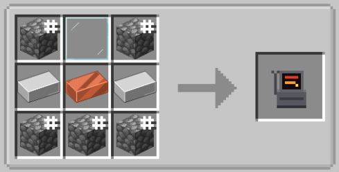

**English** | [简体中文](README-zh.md)

# Ultracraft

The real ULTRAKILL, played inside the real Minecraft 1.21.11. ULTRAKILL runs alongside Minecraft and is drawn into its window; Minecraft's blocks and mobs become ULTRAKILL's world and enemies. Bosses with modifiers, P, the shop, upgrades, arenas themed after its layers, its music in fights, the Cyber Grind, cheats, and LAN co-op.

You need to own **ULTRAKILL** (Steam) and **Minecraft Java Edition**. Windows only.

## Install

You don't install anything into ULTRAKILL yourself. When Minecraft starts, Ultracraft finds ULTRAKILL through Steam and sets it up: it adds BepInEx 5 if ULTRAKILL doesn't have it yet, and the UltraBridge plugin, updated with every new version of the mod. A toast on the title screen says what it did. Have Steam running.

Play that instance. ULTRAKILL starts by itself (and closes with Minecraft), skipping both intro scenes to the main menu and straight on into the Sandbox; open a world and you become V1 (F8 toggles back to Steve).

**By hand:** install **Fabric Loader** for Minecraft **1.21.11** (https://fabricmc.net/use/installer/), and put **Fabric API** for 1.21.11 (https://modrinth.com/mod/fabric-api) and `ultracraft-x.y.z.jar` (from `Ultracraft.zip` in the Releases) in your `mods` folder.

ULTRAKILL not found (installed somewhere unusual)? Put its folder in `config/ultracraft.properties` as `ultrakillDir=D:\\Games\\ULTRAKILL` (double backslashes). It already has BepInEx 6? Ultracraft needs BepInEx 5. Still stuck: unzip BepInEx 5 (x64, https://github.com/BepInEx/BepInEx/releases) into the ULTRAKILL folder yourself, and put `UltraBridge.dll` from `Ultracraft.zip` in `ULTRAKILL/BepInEx/plugins/UltraBridge/`.

Chinese text in the terminal needs one extra font pack, because ULTRAKILL's own font has no CJK glyphs. `GpVCTweaks` brings one; without that mod, drop any `fontpack.bundle` into `ULTRAKILL/BepInEx/plugins/UltraBridge/`. Without it the terminal stays English and the rest of the translation is unaffected.

Commands: `/uc help`. On someone else's world, the ones that hand things out (P, weapons, upgrades, calling bosses) are for the host and operators.

Minecraft crashes at launch with "Unsupported class file major version 65"? Your Fabric Loader is too old for Minecraft 1.21.11: run the latest Fabric installer (https://fabricmc.net/use/installer/), install the newest loader (0.19 or later) for 1.21.11, and start that profile.

What changed in each version: [changelog](CHANGELOG.md), and every version has its own notes on the [Releases](https://github.com/oneotok1/Ultracraft-Deep/releases) page.

## Settings

**Ultracraft...** (title screen, pause menu, Options, or `/uc settings`) has a page for each of these:
- **Enemies & Bosses**: Minecraft's mobs, ULTRAKILL's enemies, bosses (the time between them, their difficulty, how often they bring traits), arenas, enemies as Steve, the **Mob Damage Filter** to configure which mobs ULTRAKILL can touch, the **Enemy Spawn Filter** to choose which of ULTRAKILL's enemies turn up in the dark, and the **Boss Trait Filter** to keep traits off a boss's random draw.
- **Gameplay**: becoming V1, what breaks blocks, blasts putting fires out, fall damage on flung mobs, extra blood as health, impact frames, starting ULTRAKILL with Minecraft.
- **Shop & Rewards**: style rewards, the style streak text display, the OP Shop, the sharp shop screen.
- **Performance**: ULTRAKILL's resolution and frame rate, frame lock step, low-latency frames.
- **Music**: ULTRAKILL's fight music, boss themes, calm music, volumes.
- **Cheats**: ULTRAKILL's Sandbox cheats and Ultracraft's.
- **ULTRAKILL Settings**: sensitivity, field of view, screen shake and the rest, as Ultracraft plays them.
- **ULTRAKILL Controls**: rebind ULTRAKILL's keys, and give each weapon its own key.

## Enemies, arenas and rewards

ULTRAKILL's enemies spawn in the dark, and which ones depends on where you are:
- husks on the plains;
- Greed's soldiers, idols and sentries in deserts and badlands;
- Gluttony's flesh in swamps;
- Violence's machines in jungles and deep caves;
- in the Nether, demons by biome: souls in soul sand valleys, flesh in crimson forests, industry in basalt deltas;
- in the End, angels (Virtues, Powers, Providence).

The **Enemy Spawn Filter** (under Enemies & Bosses) decides which of them may turn up at all; bosses and the Cyber Grind's waves are not affected by it.

ULTRAKILL's enemies fight Minecraft's hostile mobs too. A swing, stomp, Virtue pillar or blast that would launch V1 launches a mob just as far, and V1's own blasts throw them too. A mob knocked about like that takes fall damage when it comes down, so a hard enough launch is lethal — **Knockback Fall Damage** (Gameplay, on by default) turns that off and leaves ULTRAKILL's own rule, where nothing hurts a flung mob until it lands.

**V1's health scales with Minecraft's.** V1's 100 health (200 on a full bar) scales directly with your Minecraft maximum health: 20 health corresponds to 100, and a Health Boost or heart-increasing mods scale V1's pool with it (up to 4x V1's own full health: 400 at 100, 800 on Harmless). Absorption hearts from golden apples or potions render as a darker segment on top of the ULTRAKILL health bar. Both Minecraft and ULTRAKILL hits draw from this absorption pool. With **Extra Blood Counts as Health Cap** enabled (Gameplay settings, on by default), healing and blood absorption refill the yellow hearts up to the cap; with it off, they act as a damage-soaking shield only.

**A mob's swing flashes yellow first.** That is a warning, not a promise: punch inside the window to parry it, step out of reach to dodge, or stand still and take it. Mobs armed with spears flash at the spear's full reach rather than punching distance, giving you a proper parry window before the thrust lands.

**Blasts carve spherical craters.** Explosions hollow out smooth spheres rather than jagged raycast craters, with damage tapering off towards the perimeter. Explosions deal no damage to dropped item entities, ensuring mob loot survives the blast. **Blasts Put Fire Out** (Gameplay) extinguishes nearby flames, including fires ignited by the blast itself.

**Mob Damage Filter** (under Enemies & Bosses) lets you choose which Minecraft mobs ULTRAKILL can touch. Filtered mobs are completely invisible to ULTRAKILL: weapons pass through them, punches cannot parry them, Whiplash cannot grab them, explosions ignore them, and ULTRAKILL enemies disregard them. The menu includes All, Invert, and Defaults toggles across four categories (hostile, neutral, passive, other), alongside a search box supporting JEI-style syntax (`-` to exclude, `|` for OR, spaces for AND).

**Arenas** generate in new parts of the world, one for each of ULTRAKILL's layers:
- Prelude, Limbo, Lust, Gluttony, Greed, Wrath and Violence in the Overworld;
- Heresy in the Nether;
- a Prime Sanctum in the End.

Each has a boss waiting. Step inside the ring as V1 to fight it, with the layer's own song. Beat it and a chest of loot appears on the dais. `/locate structure #ultracraft:arenas` finds the nearest one.

**Style rewards**: kills on Minecraft mobs count towards your style rank and multi-kill chains. Kills at style rank S and up pay extra experience and loot. Every fifth kill in a row at that rank pays out for sure, with P on top. The loot gets better with the rank: diamonds and golden apples at SSS, netherite at ULTRAKILL.

## Music

**Ultracraft... → Music → Fight Music** picks what plays in fights:
- off;
- a random ULTRAKILL song each fight;
- any song from its soundtrack: the levels, the Prime Sanctums, the Cyber Grind's tracks;
- one of your own: put mp3, ogg or wav files in the `ultracraft/music` folder of your Minecraft folder (the menu has an **Open Your Music Folder** button), and they're listed under **Your Music**.

Bosses and arenas bring their own song where ULTRAKILL has one (V2: Versus, Minos Prime: Order...). Minecraft's music pauses meanwhile. **Boss Music & Intros...** changes each boss's song ((Default), off, any of ULTRAKILL's or your own). For Gabriel (both fights), Minos Prime and Sisyphus Prime it also picks their entrance: their own, or another made of ULTRAKILL's lines (Gabriel's 6-2 rematch: "IS THIS WHAT I LOST TO!? YOU'RE GETTING RUSTY, MACHINE! ...HERE AND NOW!"). Gabriel's entrance can also be set to `(Default) Auto` or `Level Intro`.

## Boss entrances and deaths

With **Boss Intros** on (Enemies & Bosses; Short or Full), a boss arrives the way its level brings it in: ULTRAKILL's title card, its entrance animation, its voice with ULTRAKILL's subtitles. It can't be hurt until it's done. With **Boss Deaths** on, a beaten boss goes out the way its fight ends: Minos and Sisyphus Prime fall to their knees, say their last words and rise in shafts of light before they burst; Gabriel rages ("THIS IS NOT OVER!") or wonders ("Twice!?"), and vanishes.

**Each boss encounter is independent.** V2, V2 with the Whiplash arm, the Judge of Hell, and the Apostate of Hate are separate entries in Boss Setup, each with its own phase, health, speed, damage multipliers, traits, practice fights, and **Fight Now**. Gabriel's entrance follows the fight: his standard monologue on your first encounter, followed by his fiery rematch taunts on later fights. Defeated V2 bosses remain intact upon death rather than scattering into gib pieces.

## Cheats

**Ultracraft... → Cheats** has two groups:
- **ULTRAKILL's own Sandbox cheats**: noclip, flight, invincibility, no weapon cooldown, infinite wall jumps, blind enemies, enemy infighting, Kill All Enemies, the **Spawner Arm** (off by default; turn it on here to get it in weapon slot 6) and more.
- **Ultracraft's**: Infinite P, All Weapons & Arms, One-Hit Kills, Slow Motion, Super Speed, Infinite Stamina, Never Hungry.
- **Boss Setup...**: a page per boss. First encounter or rematch (V2, Gabriel), in rotation or not, practice fights, health/speed/damage multipliers, second phase from the start, random/no/picked traits, its level's quirks (V2 retreating, Cerberus waking one at a time, paying the Ferryman a coin, the Primes' Cyber Grind versions), its music and entrance, and **Fight Now**.

They're Ultracraft's settings: ULTRAKILL's own save and settings are never touched. In your own world (singleplayer, or one you host) they're always available; on someone else's server, only for operators.

## If it's laggy

Two games run at once and share your graphics card. In **Ultracraft... → Performance**:
- **Low-End PC Preset**: one click sets everything below to its cheap option (each can still be changed after); **Reset to Defaults** undoes it.
- **ULTRAKILL Resolution**: 540p, 480p or 360p is the biggest frame rate win (720p is the default).
- **Effects Quality**: Medium or Low uses ULTRAKILL's simpler explosions, fire and spawn effects. It also turns off environment particles and keeps less gore on screen. Low also drops hit sparks and shadows.
- **Blood Stains**: how many stay painted on Minecraft's blocks (Off, 500, 1,500, 4,096 or All).
- **Extra Gore**: off leaves only ULTRAKILL's own blood on deaths.
- **Terrain Range**: 64 or 96 blocks of terrain sent to ULTRAKILL instead of 128 (less work for both games).
- **ULTRAKILL FPS Cap**: Match Minecraft (the default) follows Minecraft's frame limit, the smoothest (as V1, Minecraft shows every ULTRAKILL frame once, in step with it); a lower cap leaves Minecraft more room on a weak graphics card.
- **Low-Latency Frames** (on by default): ULTRAKILL hands each frame over as soon as it's drawn: less input lag.
- **Sharp Shop Screen**: off.

Also: Minecraft render distance 8-12 chunks. ULTRAKILL's own graphics options (in ULTRAKILL itself) apply too.

**Sodium and Iris** work with Ultracraft (tested with Sodium 0.8.14 and Iris 1.10.8 on 1.21.11): put them in the mods folder for a faster Minecraft side. Shader packs are untested.

**ULTRAKILL-side hand and weapon skins carry over to Minecraft.** With a skin plugin such as UltraSkins installed, the first-person arm shows your selected skin, glow layer included, with nothing to configure.

## Multiplayer

Everyone plays with their own ULTRAKILL (it starts by itself when Minecraft does), and everyone needs the same mods.

- **Easiest: [Essential](https://essential.gg)** (Fabric, 1.21.11) in the mods folder: host your world from Essential's menu and invite your friends; they join from their invites. Works with Ultracraft out of the box.
- Or **Open to LAN** from the pause menu (same network, or with a tunnel).

You share the world and the fight: each player's ULTRAKILL runs the enemies around them, and the others see and hit them too. Other players show up as V1, holding the gun they have out, and you see and hear what they do: their beams, projectiles, explosions and shots. Each player has their own P, gear and upgrades; `/uc p give <player> <amount>` hands some of yours to someone else.

Over ULTRAKILL's view, each other player has their name, health and distance over their head, seen through walls, and at the screen's edge when they're off it (**Teammate Markers**, Gameplay settings).

Bosses fight every V1 nearby: one goes for whoever hurts it most and is close, holds on to them for a few seconds, and now and then turns on someone else. Everyone but the player it came for sees its health in a boss bar.

Die in a boss fight (or a Cyber Grind run) while a teammate fights on and you're only **down**: the camera follows a teammate (the mouse turns it round them, left and right click switch teammate), and a marker of green light stands where you fell. A teammate who stands on it for 4 seconds (2 with two of them) brings you back up right there. Otherwise you're back beside them once the boss is beaten or the Grind's wave is cleared. Only when everyone is down is it lost.

**Kill attribution and damage consistency:** A kill goes to whoever fired the finishing shot: style points, multi-kill chains, and experience are awarded directly to that player. Enemy swings deal their true damage across the network bridge rather than being amplified in multiplayer.

**Duels**: `/uc duel <player>` challenges another V1; they accept with a click in chat (or `/uc duel accept`). After a countdown your shots, punches and blasts hurt each other (half as hard as they'd hurt a mob). The first V1 down loses, nobody actually dies, and both get back up at full health. `/uc duel forfeit` gives up.

## Controls

**Ultracraft... → ULTRAKILL Controls...** rebinds ULTRAKILL's keys (movement, dash, slide, fire, punch, arm, whiplash, weapons...). Click an action, press the key or mouse button; Esc cancels. Minecraft's own action on that key steps aside while you're V1 with guns out. F8 switches V1/Steve and V switches guns/Minecraft hands.

Each weapon (Piercer, Marksman, Core Eject, Firestarter...) can also have its own key, which switches straight to it. They're unbound until you set them; Esc on one unbinds it. The Alternate versions share their colour's key.

**Whiplash drags Minecraft mobs.** Hooking a mob with the Whiplash reels it towards you: pulled mobs pause their attacks while being dragged, their physics remain active, and fast reels smoothly pull them into close quarters.

With Minecraft hands out, V1 holds blocks, tools and food in ULTRAKILL's own arm (the Feedbacker's model, taken from your ULTRAKILL the first time it runs). **F5** works as V1 too: the camera moves behind V1 (or in front) and you see V1's body.

Back as Steve (F8), ULTRAKILL's enemies stay: you still see them, they still come for you (their hits cost hearts), and you can fight them as Steve. Turn **ULTRAKILL While Steve** off to have them wait, frozen, until you're V1 again.

Your own ULTRAKILL save is never written: progress lives in the Minecraft world.

## Recipes

**Shop**: 2 iron ingots, a copper ingot, a glass pane and 5 cobblestone (or cobbled deepslate or blackstone): craftable on your first night.

Place it and walk up to it as V1: ULTRAKILL's shop terminal, where you spend P on weapons, variants and upgrades. The revolver, shotgun and nailgun pages have an **ALTERNATE** button: it buys the alternate version, and after that switches the weapon between standard and alternate.

The terminal's **Upgrades** page offers several upgrade paths bought with P and leveled via `^ v - +`. Purchased upgrades persist across visits, and downgrading retains your unlock history without refunding P.

**The Cyber Grind** starts from the shop's Cyber Grind page. With **Cyber Grind Arenas** on (Enemies & Bosses), you and the other V1s by the shop go into the Cyber Grind's arena as ULTRAKILL has it: a 16 x 16 grid of columns over the void. Every cleared wave, the columns slide into a new **pattern**, in ULTRAKILL's own `.cgp` format: melee enemies come in on its melee tiles and ranged ones on its ranged tiles, its jump pads are ULTRAKILL's real ones, and its stairs climb to the next column. The patterns are the ones in ULTRAKILL's `Cybergrind/Patterns` folder (its examples, plus any you made or downloaded: drop `.cgp` files in there) and Ultracraft's own. Every 5 waves the grid takes on one of ULTRAKILL's layers, its blocks and its sky; every 15th wave is a boss. The arena can't be broken. Its temporary shop stands on a ledge off the south side, under a column of lights: **Leave** on its Cyber Grind page takes everyone back to where they started. `/uc grind start` starts a run on your own, `/uc grind arena <n>` starts in that layer's look, `/uc grind stop` ends the run. With the setting off, the waves come round the shop you started from.

**Co-op**: anyone can join a run already going: **Join** on any shop's Cyber Grind page, or `/uc grind join`. The waves grow with every V1 fighting them. Go down and a teammate can bring you back (or you're up again when the wave is cleared); with everyone down the run is over and you all go back where you started, alive. Leave on a shop (or `/uc grind leave`) takes just you out, and if the player who started it leaves, the next one carries the run on.

When a column rises beneath you in the Cyber Grind, you are lifted smoothly onto it, with collision checks running continuously even while columns stand still.

## Made with AI

Ultracraft was coded with **Claude** (Anthropic's AI) through Claude Code: the Fabric mod, the ULTRAKILL plugin, the tests and this guide were written by Claude, directed, played and tested by a person.

All updates following the inherited 1.0.12 release were developed with **DeepSeek** (v4.1-flash/1017) and **GLM** (5.3/5.3-flash).

The full Chinese localisation (this guide, the release notes and the in-game text) was translated with **Gemini-3.8 Flash** and proofread manually.

## Build from source

- Fabric mod: JDK 21, `cd fabric && ./gradlew build` → `fabric/build/1.21.11/libs/` (`-Pmc=1.20.1` for the 1.20.1 build, in progress).
- ULTRAKILL plugin: .NET SDK, `dotnet build -c Release ultrabridge/UltraBridge.csproj -p:GameDir="<your ULTRAKILL folder>"` (it compiles against your own install's DLLs and copies the result into its BepInEx plugins).

No game files are included in this repository.
